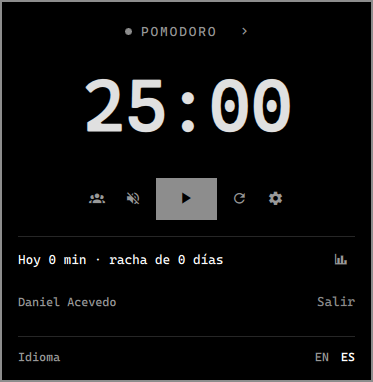
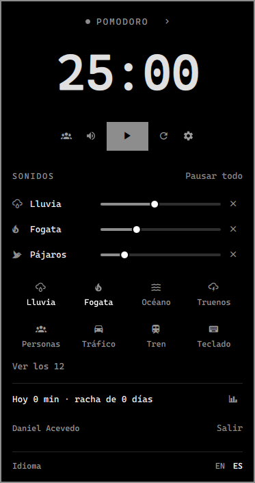
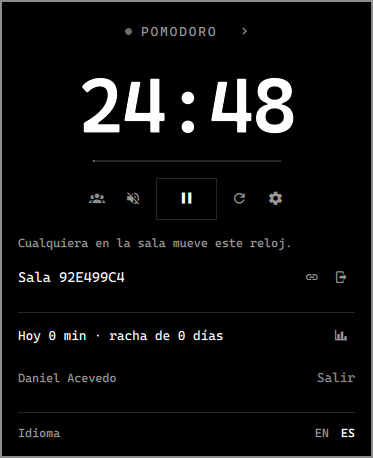
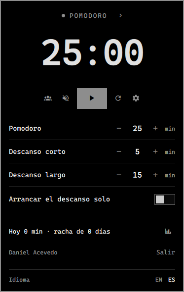

<div align="center">
  
  <h1>Doro para Omarchy</h1>
  <p>Pomodoro colaborativo en tiempo real, en tu barra de Omarchy — estudiá con amigos, mantené el ritmo, medí tu progreso.</p>

<a href="https://doro.page"></a>


<a href="LICENSE"></a>

[English](README.md) · **Español**

</div>

---

El reloj de [doro.page](https://doro.page) como plugin de la barra de
[Omarchy](https://omarchy.org): la misma cuenta, las mismas salas y el mismo dashboard que
la web, sin abrir el navegador.

## Capturas

| Reloj                                       | Sonidos ambientales                           |
| ------------------------------------------- | --------------------------------------------- |
|   |  |

| Sala compartida                                 | Tiempos                                       |
| ----------------------------------------------- | --------------------------------------------- |
|      |   |

| En la barra                                                                                 |
| ------------------------------------------------------------------------------------------- |
|  <br>  |

Hay más vistas, en inglés y en español, en [`screenshots/`](screenshots).

---

## Funcionalidades

|                                  |                                                                                    |
| -------------------------------- | ---------------------------------------------------------------------------------- |
| ⏱ **Pomodoro y cronómetro**      | Tiempos personalizables para foco, descanso corto y largo, con descanso automático  |
| 🤝 **Salas en tiempo real**      | Creá o unite a salas de doro.page — el reloj se sincroniza para todos, web incluida |
| 🔥 **Rachas y estadísticas**     | Cada pomodoro terminado va a tu dashboard de doro.page; lo de hoy y la racha en el panel |
| 🎵 **Sonidos ambientales**       | 12 sonidos sin cortes (lluvia, fogata, océano, jazz…) con un volumen cada uno       |
| 🔐 **OAuth**                     | Google · GitHub · Discord — o acceso rápido anónimo                                 |
| 📴 **Sin conexión**              | Los pomodoros esperan en una cola con su hora real y se suben después               |
| 🎨 **Sigue tu tema**             | Colores, fuentes y el ícono de los avisos salen del tema de Omarchy                 |
| 🌐 **Inglés y español**          | Sigue el idioma del sistema, con un selector EN / ES                               |
| ⌨️ **Atajos y scripts**          | Cada acción es un comando de `omarchy-shell`                                        |

---

## Instalar

```sh
omarchy plugin add https://github.com/daniace/doro-omarchy
```

Desde una terminal, Omarchy pregunta si habilitarlo y en qué parte de la barra
ponerlo; viene marcado al lado del reloj. Con `--yes` no pregunta y usa esa ubicación.
Para moverlo después:

```sh
omarchy bar move doro.pomodoro --section right   # left | centerBegin | center | centerEnd | tray | right
```

Para que las salas se actualicen al instante, instalá el paquete `qt6-websockets` de
los repositorios de Arch y reiniciá el shell (`omarchy-restart-shell`). Sin él, las
salas funcionan igual, consultando los cambios cada 2 segundos.

## Desinstalar

```sh
omarchy plugin remove doro.pomodoro
```

Eso quita el plugin y su lugar en la barra. Lo que guardó fuera de su carpeta queda,
para que lo borres a mano:

- `~/.local/state/doro/` — la configuración, el reloj en pausa, la sesión y la cola sin
  conexión.
- `~/.local/share/applications/doro-auth.desktop` y la línea `x-scheme-handler/doro` de
  `~/.config/mimeapps.list` — solo si entraste con una cuenta desde el plugin.

Tus pomodoros, estadísticas y salas quedan en tu cuenta de doro.page.

---

## Cómo funciona

**En la barra:** el anillo de Doro, que se llena con la fase, y el tiempo al lado
cuando hay una fase en curso. Clic izquierdo abre el panel, clic derecho arranca o
pausa, clic medio pasa a la fase siguiente.

**En el panel:** la fase (tocala para pasar a la siguiente; la flechita lleva al
cronómetro), el reloj grande con su hilo, arrancar/pausar, reiniciar, los **tiempos**,
los **sonidos ambientales** y la **sala**. `Enter` arranca o pausa y `Esc` cierra. Al
terminar una fase suena la alarma de Doro y llega una notificación.

Se comporta como el reloj de la web: al terminar un pomodoro pasa al descanso corto,
al terminar un descanso vuelve al pomodoro, y con «Arrancar el descanso solo» la fase
siguiente arranca sola. Un reloj que quedó corriendo al cerrar la sesión vuelve en
pausa.

### Tus pomodoros en el dashboard

Cada pomodoro que termina se guarda en tu cuenta de doro.page con los minutos
configurados (los descansos y el cronómetro no cuentan), y el dashboard lo suma a tu día
y a tu racha. Sin cuenta, el primer pomodoro terminado crea una sesión anónima, como en
la web. **Entrar con** Google, GitHub o Discord abre el navegador y vuelve por
`doro://auth`: una sesión anónima se vincula a la cuenta y conserva lo hecho; si la
cuenta ya existía, lo anónimo se le suma.

### Salas

El botón de personas abre la sala: pegá el link de una invitación
(`doro.page/invitacion/…`), su código o el link de la sala (`doro.page/room/…`), o creá
una sala (el link de invitación queda copiado). En una sala el reloj es de todos:
cualquiera lo arranca, lo pausa o le cambia la fase y los tiempos, y cada uno suma sus
propios pomodoros al dashboard. Al volver a abrir la sesión, el plugin vuelve a entrar a
la sala en la que estaba. Los sonidos ambientales siguen siendo de cada uno; el plugin
no muestra quién está en la sala ni sus tareas.

### Idioma

Inglés o español, según el sistema (español si `LANG` empieza con `es`). Se cambia con
el selector **EN / ES** al pie del panel, o:

```sh
omarchy bar set doro.pomodoro language es   # en | es
```

---

## Atajos y scripts (IPC)

Los comandos están en inglés, igual en los dos idiomas:

```sh
omarchy-shell doro.pomodoro toggle            # arrancar / pausar
omarchy-shell doro.pomodoro reset
omarchy-shell doro.pomodoro nextMode
omarchy-shell doro.pomodoro mode stopwatch    # pomodoro | shortBreak | longBreak | stopwatch
omarchy-shell doro.pomodoro volume rain 40    # 0 lo apaga
omarchy-shell doro.pomodoro toggleAmbient     # pausar / reanudar los sonidos
omarchy-shell doro.pomodoro panel             # abrir / cerrar el panel
omarchy-shell doro.pomodoro section sounds    # el panel abierto en timer | times | sounds | room
omarchy-shell doro.pomodoro status            # JSON con la fase, el tiempo, la cuenta y la sala
omarchy-shell doro.pomodoro testNotification  # el aviso y la alarma de fin de pomodoro
omarchy-shell doro.pomodoro language es       # en | es
omarchy-shell doro.pomodoro signIn github     # google | github | discord
omarchy-shell doro.pomodoro signOut
omarchy-shell doro.pomodoro dashboard         # abre doro.page/dashboard
omarchy-shell doro.pomodoro joinRoom https://doro.page/invitacion/AB12CD34   # o el código
omarchy-shell doro.pomodoro createRoom        # y copia el link de invitación
omarchy-shell doro.pomodoro copyRoomLink
omarchy-shell doro.pomodoro leaveRoom
```

Por ejemplo, en `~/.config/hypr/bindings.conf`:

```
bindd = SUPER ALT, P, Doro: arrancar o pausar, exec, omarchy-shell doro.pomodoro toggle
```

---

## Qué usa y qué toca

- Corre dentro del proceso de `omarchy-shell`: sin servicios propios, sin root y sin
  instaladores.
- **Red:** el Supabase de doro.page por HTTPS (`/auth/v1`, `/rest/v1`,
  `/functions/v1/sumar-anonimo`) y, en una sala, por WebSocket (`/realtime/v1`). El
  proyecto y su clave anon están en `Supabase.js`; la clave es pública (la misma que
  viaja en la web) y los datos los protege la seguridad por filas de Supabase.
- **Programas:** `xdg-open` (entrar y el dashboard), `wl-copy` (copiar el link de la
  sala), `xdg-mime` (registrar `doro://`) y `omarchy-notification-send`, todos incluidos
  en Omarchy. Opcional: `qt6-websockets`.
- **Archivos:** escribe en `~/.local/state/doro/` (con permisos 700, porque
  `sesion.json` guarda los tokens de la sesión). Solo cuando elegís entrar con una
  cuenta, crea `~/.local/share/applications/doro-auth.desktop` y lo pone como manejador
  de `doro://` en `~/.config/mimeapps.list`. Solo cuando cambiás el idioma, guarda
  `language` en la entrada del widget en `~/.config/omarchy/shell.json` (lo mismo que
  `omarchy bar set`).
- Para apuntar a otro Supabase (por ejemplo, uno local), sirven el `.env` del plugin
  (ver `.env.example`) o `~/.config/doro/supabase.json`
  (`{ "url": "…", "anonKey": "…" }`).

## Stack

| Área          | Tecnología                                                           |
| ------------- | -------------------------------------------------------------------- |
| Interfaz      | QML / Qt Quick sobre Quickshell (`omarchy-shell`), kit de UI de Omarchy |
| Sonido        | QtMultimedia, dos reproductores por sonido que se turnan con un fundido |
| Backend       | Supabase (PostgreSQL + Auth + Realtime), compartido con doro.page     |
| Tiempo real   | Supabase Realtime con QtWebSockets, o consultas como respaldo         |
| Pruebas       | Node (la lógica pura de `Model.js`, `Supabase.js` y `Textos.js`)      |

## Desarrollo

Repo aparte de [Doro-Pomodoro](https://github.com/leonelcnr/Doro-Pomodoro), la web. El
código está en español, como la web: la lógica del reloj replica
`src/store/timerStore.ts` y `src/features/timer/hooks/useTimerActions.ts`, y los sonidos
son copias de los de la web (si cambian allá, hay que traerlos). Los textos visibles
están en `Textos.js`.

```sh
scripts/instalar-local.sh      # instala desde esta copia; la primera vez pregunta dónde va en la barra
node tests/model.test.mjs      # la lógica del reloj y de las salas
node tests/supabase.test.mjs   # la sesión, la cola y el resumen
node tests/textos.test.mjs     # que cada texto visible exista en inglés y en español
qs log -p "$OMARCHY_PATH/shell" --tail 100
```

El shell recarga el widget al cambiar los archivos, pero el servicio (`keepLoaded`) y
el panel ya abierto pueden quedar con la versión vieja: `omarchy-restart-shell` los
recarga.

| Archivo | Qué hace |
|---|---|
| `Service.qml` | El reloj (uno por sesión), los sonidos, lo guardado, el idioma y el IPC |
| `BarWidget.qml` | La vista de la barra (una por monitor); le pasa el ajuste `language` al servicio |
| `Panel.qml` | El panel; los sonidos con la vista del mezclador de la web |
| `AnilloDoro.qml` | El logo de Doro dibujado con los colores del tema |
| `SonidoSinCortes.qml` | Un sonido ambiente en bucle sin cortes |
| `Model.js` | La lógica pura del reloj, la misma de `timerStore`, y la del reloj compartido |
| `Nube.qml` | La sesión con doro.page, los pomodoros del dashboard (con cola sin conexión) y el resumen |
| `Sala.qml` | Entrar, crear y salir de salas; `timer_state` por Realtime o consultas cada 2 s |
| `Supabase.js` | La lógica pura de la sesión, la vuelta del OAuth, la cola y el resumen |
| `Textos.js` | Los textos visibles en inglés y español |

## Créditos

Los sonidos ambientales, la alarma y el tick son los mismos que usa doro.page. Salen de
[Pixabay](https://pixabay.com/es/sound-effects/) (con la
[licencia de contenido de Pixabay](https://pixabay.com/es/service/license-summary/)) y
de [Freesound](https://freesound.org/) (con la licencia Creative Commons de cada sonido).

## Licencia

El código es [MIT](LICENSE), © 2026 Daniel Emiliano Acevedo y Leonel Jeremias Canario. Los sonidos
mantienen sus propias licencias (ver [Créditos](#créditos)).
