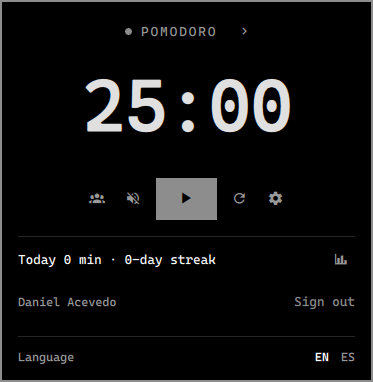
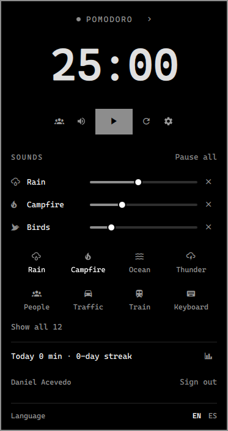
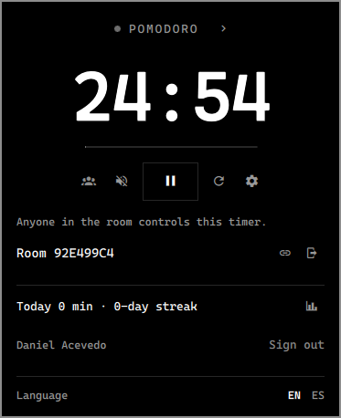
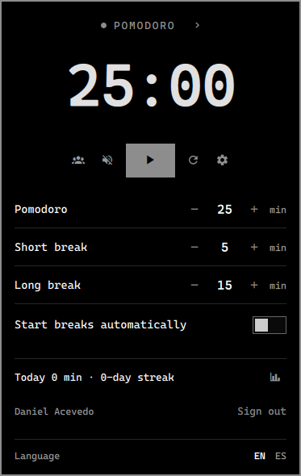

<div align="center">
  
  <h1>Doro for Omarchy</h1>
  <p>Real-time collaborative Pomodoro, right in your Omarchy bar — study with friends, keep the rhythm, track your progress.</p>

<a href="https://doro.page"></a>


<a href="LICENSE"></a>

**English** · [Español](README.es.md)

</div>

---

The [doro.page](https://doro.page) timer as an [Omarchy](https://omarchy.org) bar plugin:
the same account, the same rooms and the same dashboard as the web, without opening the
browser.

## Screenshots

| Timer                                       | Ambient sounds                                |
| ------------------------------------------- | --------------------------------------------- |
|   |   |

| Shared room                                     | Times                                       |
| ----------------------------------------------- | ------------------------------------------- |
|      |   |

| In the bar                                                                                 |
| ------------------------------------------------------------------------------------------ |
|  <br>  |

More views, in English and Spanish, are in [`screenshots/`](screenshots).

---

## Features

|                                  |                                                                                   |
| -------------------------------- | --------------------------------------------------------------------------------- |
| ⏱ **Pomodoro and stopwatch**     | Custom focus, short and long break times, with automatic breaks                    |
| 🤝 **Real-time rooms**           | Create or join doro.page rooms — the timer stays in sync with everyone, web included |
| 🔥 **Streaks and stats**         | Every finished pomodoro goes to your doro.page dashboard; today and your streak in the panel |
| 🎵 **Ambient sounds**            | 12 gapless sounds (rain, campfire, ocean, jazz…) with a volume each                |
| 🔐 **OAuth**                     | Google · GitHub · Discord — or quick anonymous access                              |
| 📴 **Works offline**             | Pomodoros wait in a queue with their real time and upload later                    |
| 🎨 **Follows your theme**        | Colors, fonts and the notification icon come from the Omarchy theme                |
| 🌐 **English and Spanish**       | Follows the system language, with an EN / ES switch                               |
| ⌨️ **Keybindings and scripts**   | Every action is an `omarchy-shell` command                                         |

---

## Install

```sh
omarchy plugin add https://github.com/daniace/doro-omarchy
```

From a terminal, Omarchy asks whether to enable it and where in the bar to put it;
next to the clock is preselected. With `--yes` it doesn't ask and uses that spot. To
move it later:

```sh
omarchy bar move doro.pomodoro --section right   # left | centerBegin | center | centerEnd | tray | right
```

For instant updates in rooms, install the `qt6-websockets` package from the Arch
repositories and restart the shell (`omarchy-restart-shell`). Without it, rooms still
work by checking for changes every 2 seconds.

## Uninstall

```sh
omarchy plugin remove doro.pomodoro
```

That removes the plugin and its place in the bar. What it saved outside its folder
stays, so you can delete it by hand:

- `~/.local/state/doro/` — settings, the paused timer, the session and the offline queue.
- `~/.local/share/applications/doro-auth.desktop` and the `x-scheme-handler/doro` line
  in `~/.config/mimeapps.list` — only if you signed in from the plugin.

Your pomodoros, stats and rooms stay in your doro.page account.

---

## How it works

**In the bar:** the Doro ring, which fills up with the phase, and the time next to it
while a phase is running. Left click opens the panel, right click starts or pauses,
middle click skips to the next phase.

**In the panel:** the phase (click it to skip; the arrow switches to the stopwatch),
the big clock with its progress line, start/pause, reset, **times**, **ambient
sounds** and the **room**. `Enter` starts or pauses and `Esc` closes it. When a phase
ends, the Doro alarm plays and a notification shows up.

It behaves like the web timer: after a pomodoro comes a short break, after a break a
pomodoro, and with «Start breaks automatically» the next phase starts on its own. A
timer left running when the session closed comes back paused.

### Your pomodoros on the dashboard

Every finished pomodoro is saved to your doro.page account with its configured minutes
(breaks and the stopwatch don't count), and the dashboard adds it to your day and your
streak. Without an account, the first finished pomodoro creates an anonymous session,
as on the web. **Sign in with** Google, GitHub or Discord opens the browser and comes
back through `doro://auth`: an anonymous session gets linked to the account and keeps
what you did; if the account already existed, the anonymous work is added to it.

### Rooms

The people button opens the room section: paste an invite link
(`doro.page/invitacion/…`), its code or a room link (`doro.page/room/…`), or create a
room (the invite link gets copied). In a room the timer is everyone's: anyone can
start it, pause it or change its phase and times, and each person adds their own
pomodoros to the dashboard. When the session opens again, the plugin rejoins the room
it was in. Ambient sounds stay personal; the plugin doesn't show who's in the room or
its tasks.

### Language

English or Spanish, following the system (Spanish if `LANG` starts with `es`). Change
it with the **EN / ES** switch at the bottom of the panel, or:

```sh
omarchy bar set doro.pomodoro language es   # en | es
```

---

## Keybindings and scripts (IPC)

```sh
omarchy-shell doro.pomodoro toggle            # start / pause
omarchy-shell doro.pomodoro reset
omarchy-shell doro.pomodoro nextMode
omarchy-shell doro.pomodoro mode stopwatch    # pomodoro | shortBreak | longBreak | stopwatch
omarchy-shell doro.pomodoro volume rain 40    # 0 turns it off
omarchy-shell doro.pomodoro toggleAmbient     # pause / resume the sounds
omarchy-shell doro.pomodoro panel             # open / close the panel
omarchy-shell doro.pomodoro section sounds    # the panel open on timer | times | sounds | room
omarchy-shell doro.pomodoro status            # JSON with the phase, the time, the account and the room
omarchy-shell doro.pomodoro testNotification  # the end-of-pomodoro notification and alarm
omarchy-shell doro.pomodoro language es       # en | es
omarchy-shell doro.pomodoro signIn github     # google | github | discord
omarchy-shell doro.pomodoro signOut
omarchy-shell doro.pomodoro dashboard         # opens doro.page/dashboard
omarchy-shell doro.pomodoro joinRoom https://doro.page/invitacion/AB12CD34   # or the code
omarchy-shell doro.pomodoro createRoom        # and copies the invite link
omarchy-shell doro.pomodoro copyRoomLink
omarchy-shell doro.pomodoro leaveRoom
```

For example, in `~/.config/hypr/bindings.conf`:

```
bindd = SUPER ALT, P, Doro: start or pause, exec, omarchy-shell doro.pomodoro toggle
```

---

## What it uses and what it touches

- It runs inside the `omarchy-shell` process: no services of its own, no root, no
  installers.
- **Network:** doro.page's Supabase over HTTPS (`/auth/v1`, `/rest/v1`,
  `/functions/v1/sumar-anonimo`) and, in a room, over WebSocket (`/realtime/v1`). The
  project and its anon key are in `Supabase.js`; the key is public (the same one the
  web ships) and the data is protected by Supabase's row-level security.
- **Programs:** `xdg-open` (sign-in and dashboard), `wl-copy` (copying the room link),
  `xdg-mime` (registering `doro://`) and `omarchy-notification-send`, all included in
  Omarchy. Optional: `qt6-websockets`.
- **Files:** it writes to `~/.local/state/doro/` (mode 700, since `sesion.json` holds
  the session tokens). Only when you choose to sign in, it creates
  `~/.local/share/applications/doro-auth.desktop` and sets it as the `doro://` handler
  in `~/.config/mimeapps.list`. Only when you change the language, it saves `language`
  in the widget's entry in `~/.config/omarchy/shell.json` (the same as
  `omarchy bar set`).
- To point at another Supabase (for example a local one), use the plugin's `.env`
  (see `.env.example`) or `~/.config/doro/supabase.json`
  (`{ "url": "…", "anonKey": "…" }`).

## Stack

| Area      | Technology                                                       |
| --------- | ---------------------------------------------------------------- |
| UI        | QML / Qt Quick on Quickshell (`omarchy-shell`), Omarchy UI kit    |
| Sound     | QtMultimedia, two offset players per sound for gapless loops      |
| Backend   | Supabase (PostgreSQL + Auth + Realtime), shared with doro.page    |
| Real time | Supabase Realtime over QtWebSockets, or polling as a fallback     |
| Tests     | Node (the pure logic in `Model.js`, `Supabase.js` and `Textos.js`) |

## Development

A separate repo from [Doro-Pomodoro](https://github.com/leonelcnr/Doro-Pomodoro), the
web app. The code is in Spanish, like the web: the timer logic mirrors
`src/store/timerStore.ts` and `src/features/timer/hooks/useTimerActions.ts`, and the
sounds are copies of the web's (if they change there, bring them over). The visible
texts live in `Textos.js`.

```sh
scripts/instalar-local.sh      # installs from this copy; the first time it asks where it goes in the bar
node tests/model.test.mjs      # timer and room logic
node tests/supabase.test.mjs   # session, queue and summary
node tests/textos.test.mjs     # every visible text exists in English and Spanish
qs log -p "$OMARCHY_PATH/shell" --tail 100
```

The shell reloads the widget when files change, but the service (`keepLoaded`) and an
already open panel may keep the old version: `omarchy-restart-shell` reloads them.

| File | What it does |
|---|---|
| `Service.qml` | The timer (one per session), the sounds, saved state, the language and the IPC |
| `BarWidget.qml` | The bar view (one per monitor); passes the `language` setting to the service |
| `Panel.qml` | The panel; the sounds use the web's mixer layout |
| `AnilloDoro.qml` | The Doro logo drawn with the theme colors |
| `SonidoSinCortes.qml` | A gapless looping ambient sound |
| `Model.js` | The pure timer logic, the same as `timerStore`, and the shared-timer logic |
| `Nube.qml` | The doro.page session, the dashboard pomodoros (with an offline queue) and the summary |
| `Sala.qml` | Joining, creating and leaving rooms; `timer_state` over Realtime or polling every 2 s |
| `Supabase.js` | The pure session, OAuth callback, queue and summary logic |
| `Textos.js` | The visible texts in English and Spanish |

## License

[MIT](LICENSE), © 2026 Daniel Emiliano Acevedo and Leonel Jeremias Canario.
